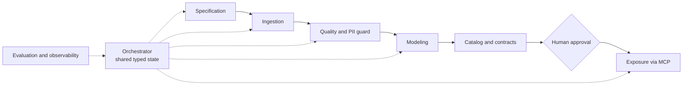

# payments-data-harness

A multi-agent data harness for the payments domain. Specialized agents take a data product from specification to exposure, with governance, PII/PCI guardrails and observability built into the pipeline instead of added afterwards.

> **Status: early development.** The repository currently contains the project scaffold. Every component below is marked with its real status. Nothing is described as working until it is.

This is a personal engineering project. It uses only public data and synthetic data. It is not affiliated with any company and does not contain proprietary or customer information.

## Why this project exists

Payment companies hold large volumes of sensitive data and need many data products built on top of it. The slow part is rarely the SQL. It is the chain around it: understanding the request, ingesting the source, proving the data is clean, keeping card numbers and personal identifiers out of places they must not be, documenting lineage, and exposing the result safely.

This project explores whether that chain can be split into small, specialized agents with explicit contracts, a shared typed state and a human approval gate, and what it takes to make that trustworthy: evaluation, logs, traces and access control.

## Architecture



| Stage | Agent | Responsibility | Status |
|---|---|---|---|
| Specification | Specifier | Turns a business request into a structured spec with acceptance criteria | Planned |
| Ingestion | Ingestor | Pulls source data, tracks origin, writes the raw layer | Planned |
| Quality and PII | Guard | Validates data, detects and masks sensitive fields, blocks unsafe output | Planned |
| Modeling | Modeler | Builds silver and gold tables with idempotent loads | Planned |
| Exposure | Exposer | Serves governed data to other agents through an MCP server | Planned |

Every agent will have a written contract: inputs, outputs, allowed tools and limits. Handoffs carry a validated payload, and a failed validation stops the run.

## Design principles

- **Typed contracts between agents.** A handoff is a schema, not free text.
- **Sensitive data is handled in two layers.** In the data (masked views, restricted raw tables) and in agent behavior (input and output guardrails).
- **Nothing reaches the gold layer without passing quality tests and a human approval.**
- **Every behavior change is measured.** Prompts and models are compared against a reference set before they are accepted.
- **Decisions are recorded.** Architecture choices live in `docs/adr/` with the alternatives that were rejected.

## Data

- **Public data.** Aggregated payment statistics published by the Central Bank of Brazil through its open data portal. These contain no personal data.
- **Synthetic data.** Generated transactions with fake national IDs and test card numbers, used only to exercise the PII and PCI controls. None of it is real.

No real customer or cardholder data is used, stored or required.

## Roadmap

- [x] Repository scaffold with `src` layout
- [ ] Code quality tooling and CI on every pull request
- [ ] API client and ingestion for the public data source
- [ ] Bronze, silver and gold layers with idempotent loads
- [ ] Data contracts, quality tests and catalog
- [ ] PII and PCI detection, masking and adversarial tests
- [ ] Reference set and automated evaluation of agent answers
- [ ] MCP server exposing governed tables as read-only tools
- [ ] Multi-agent orchestration with checkpoints and human approval
- [ ] Observability: structured logs, traces, cost and quality metrics
- [ ] Architecture decision records

## Getting started

Requirements: Python 3.12 or newer and [uv](https://docs.astral.sh/uv/).

```bash
git clone https://github.com/VitorSMarinho/payments-data-harness.git
cd payments-data-harness
uv sync
uv run payments-data-harness
```

At this stage the command only prints a greeting. It confirms the package installs and runs.

## Repository layout

```text
src/payments_data_harness/   package source
tests/                       automated tests
docs/adr/                    architecture decision records
```

## Security

Secrets are never committed. `.env` files and local data directories are ignored by Git. If you find a security problem, please open an issue without including sensitive details.

## License

Released under the [MIT License](LICENSE).

## Author

Built by VSM AI Data Engineer.
